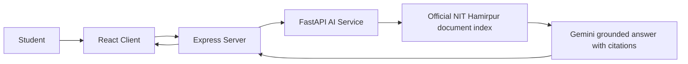

# Architecture

The system is split into three main layers:

1. React frontend for chat interactions
2. Express backend for API orchestration and session persistence
3. FastAPI AI service for NIT Hamirpur document retrieval and Gemini answer generation

## Data flow

## Responsibilities
- Frontend: user experience, messages, chat state, session list
- Backend: validation, routing, persistence, request relay
- AI service: question cleaning, official-document retrieval, Gemini generation, source packaging

## Current implementation
The AI service reads a local index generated from official PDFs published by NIT Hamirpur. `scripts/ingest_nith_documents.py` fetches the allowlisted sources in `ai-service/data/nith_sources.json`, extracts page text, and writes chunk records with source URL and page metadata. The PDFs are not retained; the derived text index is local and ignored by Git.

Gemini is called by the FastAPI service using the server-side `GEMINI_API_KEY`; the credential is not sent to the client. If the key is missing, the service reports that configuration error instead of returning a fabricated generated answer. If no relevant official passages are found, Gemini is not called.
