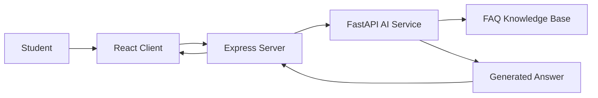

# Architecture

The system is split into three main layers:

1. React frontend for chat interactions
2. Express backend for API orchestration and session persistence
3. FastAPI AI service for retrieval and answer generation

## Data flow

## Responsibilities
- Frontend: user experience, messages, chat state, session list
- Backend: validation, routing, persistence, request relay
- AI service: question cleaning, retrieval, generation, source packaging

## Current implementation
This project uses a local JSON-backed demo setup so it can run without external databases. It is structured so the same interfaces can later be swapped for MongoDB, ChromaDB, and Ollama-backed services.
